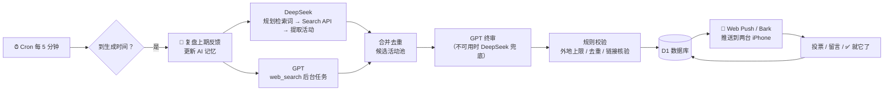

<p align="center">
  
</p>

<h1 align="center">周末去哪儿 · Weekend Planner</h1>

<p align="center">
  给两个人用的周末活动推荐 App：AI 联网搜索本周末的真实活动，结合你们的偏好每周定时推送到 iPhone，<br>
  两个人都能投票、留言，AI 会记住你们的选择，越用越懂你们。
</p>

<p align="center">
  <a href="https://deploy.workers.cloudflare.com/?url=https://github.com/jinjian28/weekend-planner"></a>
</p>

<p align="center">
  <a href="https://github.com/jinjian28/weekend-planner/actions/workflows/test.yml"></a>
  <a href="LICENSE"></a>
  
  
</p>

---

## ✨ 功能

- **每周定时推送**（默认周四 18:30，可改）一份周末备选清单：
  - 🎟️ **实时活动**：AI 联网搜索你所在城市本周末的演出、展览、市集、节日活动、热映电影等，附时间、地点、价格、购票/报名链接和信息来源。
  - 💡 **个性化建议**：根据你们的爱好、上次做某事的时间（「有段时间没一起爬山了」）、天气（下雨推荐室内，晚霞指数高推荐看日落）和季节来推荐。
- **双路 AI 检索 + 终审**：DeepSeek（官方 Search API）和 OpenAI GPT（web_search）各自独立搜索，合并去重后由 GPT 终审。GPT 不可用时自动由 DeepSeek 兜底，**只用 DeepSeek 也能完整运行**。
- **两个人一起决定**：每条都能投「想去 / 再看看 / 不想去」、留言，对方的意见实时可见；定下来点「✅ 就它了」。对方留言或定计划时会收到推送。
- **AI 记忆**：每次生成前，AI 会复盘上一期的投票、留言和最终选择，更新你们的偏好；你们也可以直接「告诉 AI」一些要求。
- **周边城市**：可以设置周边城市和车程，越远的城市推荐得越少，每期外地活动不超过 2 条。
- **成本透明**：每期底部显示本期 token 用量、花费估算和 DeepSeek 余额。
- **iPhone 原生体验**：添加到主屏幕后全屏运行，支持系统推送（Web Push），也可以用 Bark 作为备用推送通道；内置「推送体检」，逐项排查收不到通知的原因。
- **免费部署**：只用 Cloudflare 免费版（Workers + D1 + Cron），不需要服务器，没有任何 npm 运行时依赖。

## 🚀 快速开始

### 方式一：一键部署（推荐，约 5 分钟）

1. 点上面的 **Deploy to Cloudflare** 按钮，登录（或注册）Cloudflare，并按提示授权 GitHub。
2. 在配置页面保持默认，点 **Create and deploy**。Cloudflare 会自动：复制本仓库到你的 GitHub → 创建 D1 数据库 → 设置每 5 分钟一次的定时任务 → 部署。
3. 部署完成后打开 Worker 的网址（形如 `https://weekend-planner.<你的子域名>.workers.dev`），按初始化页面填写：访问密码、两个人的名字、城市、爱好、API Key。
4. 用 iPhone 的 **Safari** 打开同一个网址 → 分享 → **添加到主屏幕** → 从桌面图标打开 → 登录 → 开启通知。

> 需要一个 API Key：[DeepSeek](https://platform.deepseek.com/api_keys)（必需，充 ¥10 够用很久）；[OpenAI](https://platform.openai.com/api-keys)（可选）。Key 在 App 的初始化页面填写，只保存在你自己的 Cloudflare D1 里，**不要写进代码**。

### 方式二：网页手动部署（不用 GitHub，零命令行）

把 [`dist/worker.js`](dist/worker.js) 的全部内容粘贴到 Cloudflare 后台的代码编辑器里，再手动建 D1、绑定 `DB`、加 Cron。**完整的手把手教程（从注册 Cloudflare 开始）见 [docs/DEPLOY.md](docs/DEPLOY.md)。**

### 方式三：命令行（开发者）

```bash
git clone https://github.com/jinjian28/weekend-planner.git
cd weekend-planner
npm install
npx wrangler d1 create weekend-planner-db     # 把输出的 database_id 填进 wrangler.jsonc
npm run build && npx wrangler deploy
```

## 🎨 个性化

- **日常设置都在 App 里**：城市和周边城市、推送日和推送时间、每期条数、爱好、名字、AI 模型、Bark、提醒开关，在「设置」页修改即可，不用改代码。
- **初始默认值**：`src/00_config.js`（构建后位于 `dist/worker.js` 最上方的「✏️ 个性化配置区」）可以改第一次初始化时的默认名字、城市、爱好、推送时间和条数。
- **AI 风格和推荐规则**：`src/05_prompts.js`（提示词）、`src/06_pipeline.js`（挑选规则、兜底建议模板）。

## 🧠 工作原理



- 生成过程是一个**可断点续跑的状态机**，每一步的状态都存在 D1 里。单次定时任务没跑完，下一次会接着跑，不会超出 Cloudflare 免费版的单次请求和查询上限。
- OpenAI 不对部分地区开放：如果 Worker 运行在这类节点，定时任务会**换节点重试**，临近推送时间仍不可用就改用 DeepSeek，保证按时推送。
- Web Push 按 RFC 8291（aes128gcm）和 RFC 8292（VAPID）实现，VAPID 密钥首次运行时自动生成，无需任何配置。

## 💰 费用

| 部分 | 费用 |
|---|---|
| Cloudflare Workers + D1 + Cron | 免费版足够 |
| 只用 DeepSeek | 每期约 ¥1（实测约 ¥0.8） |
| 加上 OpenAI GPT | 每期粗估 ¥5–25，主要是联网搜索读网页的 token。可在设置里调低推理强度，或关闭终审联网核实 |

每期清单底部都会显示实际用量和花费估算。

## 🗂️ 项目结构

```
├── dist/worker.js        # 构建产物（单文件，可直接粘贴到 Cloudflare）
├── src/                  # 后端源码（按文件名顺序拼接）
│   ├── 00_config.js      # ✏️ 个性化配置区
│   ├── 02_db.js          # D1 表结构与读写
│   ├── 035_usage.js      # token 用量与费用估算
│   ├── 03_external.js    # OpenAI / DeepSeek / 天气（Open-Meteo）
│   ├── 04_push.js        # Web Push（RFC 8291/8292）与 Bark
│   ├── 05_prompts.js     # AI 提示词
│   ├── 06_pipeline.js    # 每周清单生成状态机
│   ├── 07_api.js         # HTTP API
│   └── 08_main.js        # 定时任务与入口
├── web/                  # PWA 前端（index.html / app.js / app.css / sw.js）
├── icons/                # App 图标（make_icons.py 生成）
├── test/                 # 自动测试：模拟 D1、AI、推送服务
├── docs/DEPLOY.md        # 从 0 开始的手把手部署教程
├── build.mjs             # 构建脚本
└── wrangler.jsonc        # Cloudflare 配置（一键部署用）
```

## 🛠️ 开发

需要 Node.js 22 或更新版本，不需要安装任何依赖就能构建和测试：

```bash
node build.mjs                    # 生成 dist/worker.js
node --no-warnings test/run.mjs   # 运行全部自动测试（约 2 分钟）
```

测试覆盖：RFC 8291 官方测试向量、VAPID 签名校验、端到端生成流程、定时推送不重复、OpenAI 地区受限 / 出错 / 返回非 JSON / 慢响应、DeepSeek 搜索失败、全部失败时的降级、推送体检与失效设备清理，以及 Cloudflare 免费版的单次 D1 查询数和子请求数上限。

改完源码后请运行 `node build.mjs` 并一起提交 `dist/worker.js`，CI 会检查两者是否一致。欢迎提 Issue 和 PR！

## 🔒 隐私与安全

- 所有数据（清单、投票、留言、AI 记忆、设置、API Key）只存在**部署者自己的** Cloudflare D1 里。
- App 用一个两人共用的访问密码保护（加盐 SHA-256 校验，失败次数过多会临时锁定）。
- 前端设置了严格的 CSP，AI 返回的内容都经过转义，链接只允许 http/https。
- 请不要把 API Key 提交到仓库。

## ⚠️ 免责声明

活动信息来自 AI 对网络公开资料的检索整理，可能有误或变动，出发前请以官方渠道为准。本项目与 Cloudflare、DeepSeek、OpenAI 均无关联。

## 📄 License

[MIT](LICENSE)

---

<details>
<summary><b>English</b></summary>

**Weekend Planner** is a tiny self-hosted PWA for two people. Every week (default: Thu 18:30 Beijing time) it searches the web for real events happening in your city this weekend, using DeepSeek's Search API and OpenAI's `web_search` independently. A GPT "judge" (with DeepSeek fallback) then merges them with personalized suggestions based on your hobbies, weather and past choices, and pushes the list to both iPhones via Web Push. Both people can vote and comment, and the AI keeps a memory of your preferences.

It runs entirely on the Cloudflare free tier (Workers + D1 + Cron Triggers) with zero runtime dependencies. Click **Deploy to Cloudflare** above, open the Worker URL, and follow the setup page. The UI is in Simplified Chinese.

</details>
